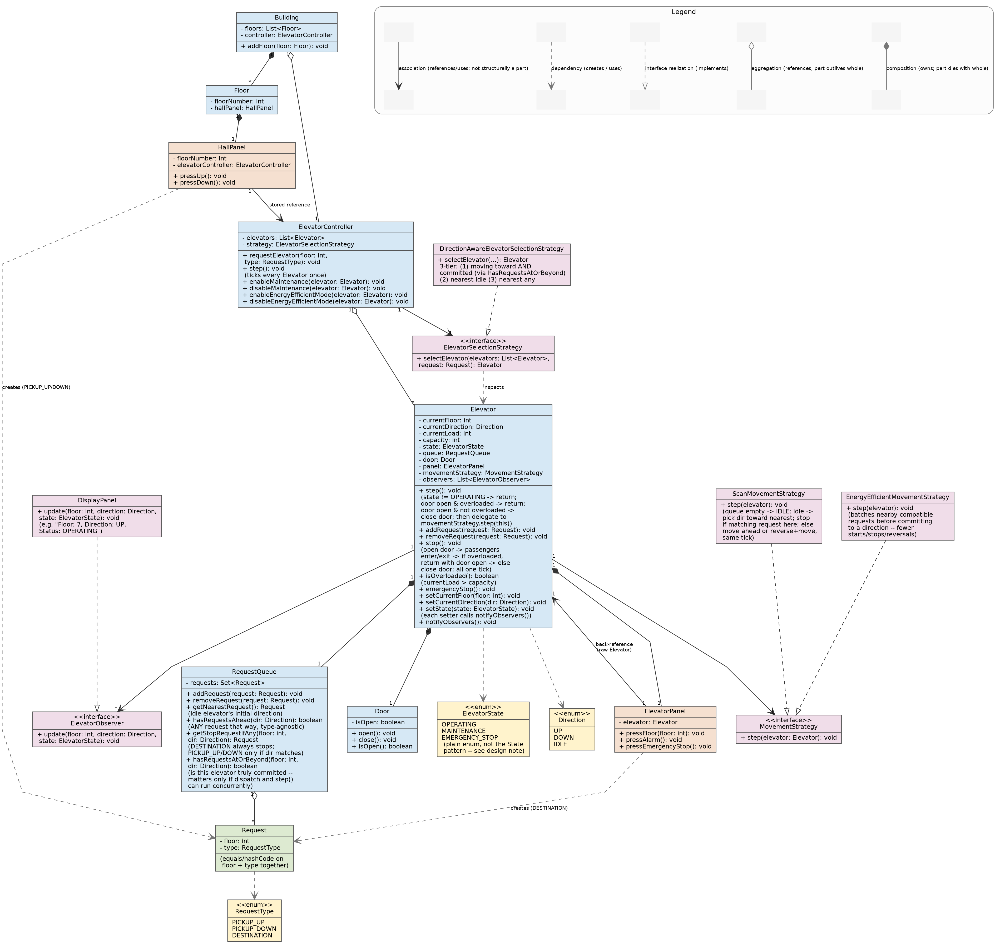

# Elevator System — Low-Level Design

A low-level object-oriented design for a multi-elevator system serving a multi-floor building.

The design supports:

* Multiple elevators
* Hall and cabin requests
* Direction-aware elevator selection
* SCAN-based elevator movement
* Door operation
* Overload protection
* Emergency stop and alarm
* Scheduled maintenance
* Energy-efficient movement
* Elevator display using the Observer pattern

The design intentionally avoids unnecessary abstractions and focuses on the requirements of the system.



---

# 1. Requirements

| #  | Requirement                        |
| -- | ---------------------------------- |
| 1  | Multiple Elevators Support: The system should support multiple elevators.               |
| 2  | Floor navigation : Floor Navigation: Ability to move to different floors and maintain the current floor state.                  |
| 3  | Request Handling: Process external requests (floor button presses) and internal requests (buttons inside the elevator).   |
| 4  | Direction and Status Indicators: Display current direction (up or down) and status (moving, idle, maintenance).  |
| 5  | Queue Management: Manage a queue of floor requests and optimize the order of execution.           |
| 6  | Overload Protection: Prevent operation if the elevator is overloaded.               |
| 7  | Emergency Handling: Implement emergency features like alarm buttons and emergency stop functionality. |
| 8  | Scheduled Maintenance Mode: Enable/disable elevators for scheduled maintenance.             |
| 9  | Energy Efficiency Mode: Optimize the operation for energy efficiency during low usage periods.        |
| 10 | User Interface and display: Provide a user interface inside the elevator for floor selection and information display.                  |

---

# 2. High-Level Architecture

```text
                         Building
                            |
                            |
                   ElevatorController
                            |
             +--------------+--------------+
             |                             |
   ElevatorSelectionStrategy          List<Elevator>
             |                             |
             |                  +----------+----------+
             |                  |          |          |
             |              Elevator    Elevator    Elevator
             |
 DirectionAwareElevatorSelectionStrategy
```

Each `Elevator` owns its own operational state:

```text
Elevator

   +-- Elevator ID
   +-- RequestQueue
   +-- Door
   +-- ElevatorPanel
   +-- MovementStrategy
   +-- ElevatorState
   +-- ElevatorObserver(s)
```

---

# 3. Core Classes

## Building

`Building` represents the building and its floors.

For this LLD it is intentionally kept lightweight.

```text
Building

   +-- Floor
   +-- ElevatorController
```

The controller can be passed to the building rather than making the building responsible for dispatch logic.

---

# 4. Floor

A `Floor` represents a physical floor.

Each floor has a `HallPanel`.

```text
Floor

   +-- floorNumber
   +-- HallPanel
```

The `Floor` does not decide which elevator should serve a request.

Its responsibility is simply to provide the location and its hall panel.

---

# 5. HallPanel

`HallPanel` represents the UP/DOWN buttons outside an elevator.

When a passenger presses a button:

```text
Passenger

    ↓

HallPanel.pressUp()

    ↓

ElevatorController.requestElevator(
    floor,
    PICKUP_UP
)
```

Similarly:

```text
HallPanel.pressDown()

    ↓

ElevatorController.requestElevator(
    floor,
    PICKUP_DOWN
)
```

The `HallPanel` does not choose an elevator.

That responsibility belongs to `ElevatorController` + `ElevatorSelectionStrategy`.

---

# 6. ElevatorPanel

`ElevatorPanel` represents controls inside the elevator.

It contains operations for:

* Selecting a destination floor
* Alarm
* Emergency stop

```java
public void pressFloor(int floor) {

    Request request =
            new Request(floor, RequestType.DESTINATION);

    elevator.addRequest(request);
}
```

The important distinction is:

```text
HallPanel

    → PICKUP_UP / PICKUP_DOWN

ElevatorPanel

    → DESTINATION
```

The cabin passenger is already inside the elevator, so there is no need to select an elevator.

---

# 7. Request

There is only one concrete `Request` class.

```text
Request

   +-- floor
   +-- RequestType
```

`RequestType`:

```text
PICKUP_UP
PICKUP_DOWN
DESTINATION
```

We deliberately do **not** use `Direction` inside `Request`.

---

# 8. Why RequestType Instead of Direction?

`Direction` represents the **current movement direction of an elevator**:

```text
UP
DOWN
IDLE
```

A hall request, however, can never be `IDLE`.
Also, Direction is not applicable in case of Destination request call.. If we use Diretion then it has to be Nullable, which is not easy to explain

For example:

```text
Request(7, PICKUP_UP)

Request(7, PICKUP_DOWN)
```

are valid.

But:

```text
Request(7, IDLE)
```

is meaningless.

Using:

```java
RequestType
```

makes this distinction explicit at the type level.

Therefore:

```text
Direction

    → Elevator's current movement

RequestType

    → What kind of request needs to be served
```

This also allows two different requests on the same floor:

```text
Request(7, PICKUP_UP)

Request(7, PICKUP_DOWN)
```

They are different requests.

---

# 9. ElevatorController

`ElevatorController` is responsible for coordinating the elevator fleet.

Its main responsibilities are:

* Receive hall requests
* Ask the selection strategy to choose an elevator
* Add the request to the selected elevator
* Advance all elevators using `step()`
* Enable/disable maintenance
* Enable/disable energy-efficient mode

Hall request flow:

```text
HallPanel

    ↓

ElevatorController.requestElevator()

    ↓

Create Request

    ↓

ElevatorSelectionStrategy

    ↓

Select Elevator

    ↓

Elevator.addRequest()
```

The controller does not implement the elevator movement algorithm.

---

# 10. ElevatorSelectionStrategy

The controller needs a way to decide which elevator should serve a hall request.

Therefore:

```java
interface ElevatorSelectionStrategy
```

Current implementation:

```text
DirectionAwareElevatorSelectionStrategy
```

The strategy considers:

1. Elevator moving toward the request in the correct direction
2. Idle elevator
3. Nearest elevator as fallback

---

# 11. Direction-Aware Elevator Selection

The selection happens in three priorities.

## Priority 1 — Moving in the correct direction

Suppose:

```text
Request:

floor = 7
type = PICKUP_UP
```

An elevator at floor 3 moving UP is a good candidate.

An elevator at floor 10 moving UP is not, because it has already passed floor 7.

An elevator moving DOWN is not a first-choice candidate.

---

## Priority 2 — Nearest idle elevator

If no suitable elevator is already moving toward the request:

```text
choose nearest IDLE elevator
```

---

## Priority 3 — Nearest elevator

If there is no idle elevator:

```text
choose nearest elevator
```

This gives:

```text
1. Correct-direction moving elevator
2. Nearest idle elevator
3. Nearest elevator
```

---

# 12. Why Check Whether an Elevator Is Committed to Reaching the Request?

This check matters when elevator movement and request assignment can happen concurrently.

Consider:

```text
Elevator:

currentFloor = 3
direction = UP

Existing queue:

floor 4
```

Now a new request arrives:

```text
floor 7
PICKUP_UP
```

At first glance, the elevator looks suitable because:

```text
current direction = UP
request direction = UP
```

But its existing queue only takes it to floor 4.

After serving floor 4, it may have no request ahead and therefore reverse.

So it is **not actually committed to reaching floor 7**.

Therefore:

```java
hasRequestsAtOrBeyond(7, UP)
```

returns:

```text
false
```

If the elevator instead has:

```text
queue = { floor 8 }
```

then:

```java
hasRequestsAtOrBeyond(7, UP)
```

returns:

```text
true
```

because the elevator is already committed to going beyond floor 7.

---

# 13. Why does this matter only in the concurrent case?

If we guarantee:

```text
request assignment happens

        BEFORE

elevator.step()
```

then this check is not necessary.

The request will simply be added to the queue before the next movement decision.

However, if these operations can happen concurrently:

```text
Thread 1                     Thread 2

elevator.step()              requestElevator()

see request floor 4

move toward floor 4

                             add floor 7 request

next step:

serve floor 4

queue appears empty

reverse DOWN
```

The elevator can reverse before the new request becomes part of its movement decision.

Therefore the commitment check is useful when request addition and movement are concurrent.

---

# 14. Elevator

`Elevator` represents one physical elevator car.

It owns:

```text
Elevator

   +-- id
   +-- currentFloor
   +-- currentDirection
   +-- currentLoad
   +-- capacity
   +-- ElevatorState
   +-- RequestQueue
   +-- Door
   +-- ElevatorPanel
   +-- MovementStrategy
   +-- ElevatorObserver(s)
```

The elevator does not implement the movement algorithm itself.

It delegates movement to:

```text
MovementStrategy
```

The elevator also has a unique ID.

The ID is useful when multiple elevators exist and multiple display panels observe different elevators.

---

# 15. ElevatorState

We use a simple enum rather than the State design pattern.

```java
public enum ElevatorState {

    OPERATING,

    MAINTENANCE,

    EMERGENCY_STOP
}
```

The states have clear responsibilities.

### OPERATING

The elevator can:

* Receive requests
* Move
* Stop
* Open/close doors

### MAINTENANCE

The elevator cannot operate for passengers.

Maintenance is controlled by:

```text
ElevatorController
```

### EMERGENCY_STOP

The elevator is stopped because of an emergency.

Emergency stop can be triggered by:

```text
Passenger

    ↓

ElevatorPanel

    ↓

Elevator.emergencyStop()
```

or by:

```text
ElevatorController

    ↓

Elevator.emergencyStop()
```

Both use the same elevator operation.

---

# 16. Maintenance and Emergency Requests

Existing requests are **not deleted** when the elevator enters maintenance or emergency mode.

Example:

```text
Elevator queue:

floor 5
floor 8
floor 10
```

Then:

```text
state = MAINTENANCE
```

The requests remain in the queue.

`Elevator.step()` simply does:

```java
if (state != ElevatorState.OPERATING) {
    return;
}
```

When the elevator returns to:

```text
OPERATING
```

the existing requests can continue to be processed.

This keeps the design simple.

A production system could reassign hall requests from a disabled elevator, but that is outside the current scope.

---

# 17. RequestQueue

Each elevator has its own `RequestQueue`.

A `Set<Request>` is used.

```java
private Set<Request> requests;
```

The reason is simple:

```text
Request(5, DESTINATION)

Request(5, DESTINATION)
```

should not result in two identical pending requests.

Since `Request` equality is based on:

```text
floor + RequestType
```

the set naturally prevents duplicates.

However:

```text
Request(5, PICKUP_UP)

Request(5, PICKUP_DOWN)
```

are different and can both exist.

---

# 18. RequestQueue Responsibilities

The queue provides three important operations.

### `getNearestRequest()`

Used when an idle elevator needs to determine its initial direction.

### `hasRequestsAhead()`

Answers:

> Is there any request further in this direction?

It does **not** care about request type.

For example:

```text
Elevator:

floor 3
direction UP

Request:

floor 5, PICKUP_DOWN
```

There is still a request ahead, so the elevator can travel toward floor 5.

But it should not stop there while moving UP.

### `getStopRequestIfAny()`

Answers:

> Should I stop at this floor while moving in this direction?

Rules:

```text
DESTINATION → always stop

PICKUP_UP   → stop while moving UP

PICKUP_DOWN → stop while moving DOWN
```

When the elevator is `IDLE` and the request is already at its current floor, either pickup direction can be served.

---

# 19. Why Travel and Stop Are Separate Questions

Consider:

```text
Elevator:

floor 3
direction UP

Request:

floor 7
PICKUP_DOWN
```

The elevator can travel UP toward floor 7 because the request is ahead.

But it should not pick up the passenger at floor 7 while moving UP.

Therefore:

```text
hasRequestsAhead()

        ↓

Should I keep travelling?

getStopRequestIfAny()

        ↓

Should I stop here?
```

This separation is essential for correct hall-call behavior.

---

# 20. MovementStrategy

Movement is extracted into:

```java
interface MovementStrategy
```

Current implementation:

```text
ScanMovementStrategy
```

A second implementation can be:

```text
EnergyEfficientMovementStrategy
```

The important distinction is:

```text
ElevatorSelectionStrategy

    → WHICH elevator should handle the request?

MovementStrategy

    → HOW should one elevator move?
```

They operate at different levels.

---

# 21. SCAN Movement

The normal movement strategy follows a SCAN-style algorithm.

Conceptually:

```text
       ↑

       |

  10   |

       |

   8   | request

       |

   7   |

       |

   5   | request

       |

   3   | elevator

       |

       ↓
```

The elevator continues in its current direction and serves compatible requests along the way.

When there are no more requests ahead, it reverses direction and continues moving.

---

# 22. Important SCAN Rule — Continue Moving After Reversal

This is one of the most important details of the implementation.

Suppose:

```text
currentFloor = 3
direction = DOWN
```

and there are no requests below floor 3, but there is a request above:

```text
Request(7, DESTINATION)
```

The elevator must not spend one tick only changing:

```text
DOWN → UP
```

Instead:

```text
same tick:

DOWN

 ↓

no request ahead

 ↓

reverse to UP

 ↓

move from floor 3 → floor 4
```

Therefore:

> **Direction reversal and movement happen in the same tick.**

This prevents the elevator from becoming stuck for an unnecessary tick after reversal.

---

# 23. Serving Requests After Reversal

After reversing, the elevator must use the **new direction** for the remainder of the same movement decision.

For example:

```text
currentFloor = 3
direction = DOWN

request = floor 4, DESTINATION
```

There is no request ahead in the DOWN direction.

So:

```text
DOWN
 ↓
reverse
 ↓
UP
 ↓
move 3 → 4
```

On the next tick:

```text
currentFloor = 4
direction = UP
```

The request at floor 4 is now evaluated using:

```text
direction = UP
```

and is served.

The important point is that reversal does not terminate the movement step.

The algorithm is:

```text
if request exists at current floor:
    serve it

else if request exists ahead:
    move in current direction

else:
    reverse direction
    move in the new direction
```

There should **not** be:

```java
direction = reverse(direction);
return;
```

because that would consume an entire tick just for reversal.

---

# 24. Why This Fixes the 3 ↔ 4 Oscillation

A common bug occurs when the elevator reaches a floor and reverses without properly considering the requests in the new direction.

For example:

```text
floor 3
direction DOWN

request at 4
```

Incorrect behavior:

```text
3 DOWN
 ↓
reverse to UP
 ↓
return

3 UP
 ↓
move to 4
```

If the movement logic then incorrectly resets/re-evaluates the direction, the elevator can repeatedly bounce:

```text
3 → 4 → 3 → 4 → 3
```

The clean solution is:

```text
No request ahead
        ↓
reverse direction
        ↓
move immediately in new direction
```

The movement strategy must preserve the new direction.

Once the elevator moves toward floor 4:

```text
floor 3 → floor 4
```

the request at floor 4 is served according to the new direction.

This keeps the SCAN algorithm moving in one direction until there are no requests ahead.

---

# 25. Tick Semantics

One `step()` represents one simulation tick.

We use these rules:

```text
Choosing a direction + moving

        = one tick

Reversing direction + moving

        = one tick

Moving one floor

        = one tick

Stopping + opening + closing door

        = one tick
```

Most importantly:

> Reversing direction is not a separate tick.

And:

> Door opening and closing during a normal stop are part of the same stop tick.

---

# 26. SCAN Step Flow

The movement strategy follows this sequence.

### Step 1 — No requests

```text
queue empty

    ↓

direction = IDLE

    ↓

return
```

---

### Step 2 — Elevator is idle

Find the nearest request.

If:

```text
request floor > current floor
```

then:

```text
direction = UP
```

If:

```text
request floor < current floor
```

then:

```text
direction = DOWN
```

If the request is already at the current floor:

```text
direction remains IDLE
```

and the request is served immediately below.

---

### Step 3 — Check whether current floor should be served

Call:

```java
getStopRequestIfAny(
    currentFloor,
    currentDirection
)
```

If a request should be served:

```text
remove request

    ↓

elevator.stop()

    ↓

return
```

Stopping consumes the current tick.

---

### Step 4 — Check whether anything is ahead

If there is a request ahead:

```text
move one floor in current direction
```

If there is nothing ahead:

```text
reverse direction
```

and:

```text
move one floor in the NEW direction
```

**Do not return after reversing.**

---

### Step 5 — Move one floor

```text
UP   → currentFloor + 1

DOWN → currentFloor - 1
```

---

# 27. Example of SCAN

Suppose:

```text
currentFloor = 3
direction = UP

queue:

    Request(5, PICKUP_UP)

    Request(7, DESTINATION)
```

Then:

```text
Tick 1:

floor 3 → floor 4

Tick 2:

floor 4 → floor 5

Tick 3:

floor 5

PICKUP_UP request found

stop()

door opens

passenger enters/exits

door closes

Tick 4:

floor 5 → floor 6

Tick 5:

floor 6 → floor 7

Tick 6:

floor 7

DESTINATION request found

stop()

door opens

passenger exits

door closes

queue empty

direction = IDLE
```

---

# 28. Reversal Example

Suppose:

```text
currentFloor = 7
direction = UP

queue:

Request(5, DESTINATION)
```

There are no requests above floor 7.

Therefore:

```text
Tick:

currentFloor = 7
direction = UP

        ↓

no request ahead

        ↓

reverse to DOWN

        ↓

move 7 → 6
```

The reversal and movement happen in the same tick.

Next:

```text
Tick:

floor 6
direction DOWN

        ↓

move 6 → 5
```

Next:

```text
Tick:

floor 5
direction DOWN

        ↓

request found

        ↓

serve request
```

This is the intended SCAN behavior.

---

# 29. Door

`Door` belongs to the elevator.

```text
Elevator

   +-- Door
```

It supports:

```java
open()

close()

isOpen()
```

The elevator controls the door through:

```java
stop()
```

---

# 30. Stop and Door Behavior

When the elevator reaches a floor requiring service:

```java
public void stop() {

    door.open();

    // passengers enter/exit

    // currentLoad may change

    if (isOverloaded()) {
        return;
    }

    door.close();
}
```

A normal stop therefore means:

```text
open door

   ↓

passengers enter/exit

   ↓

check overload

   ↓

close door
```

All of this is one tick.

---

# 31. Overload Handling

Overload is a safety condition, not an `ElevatorState`.

We therefore do not create:

```text
OVERLOADED
```

inside `ElevatorState`.

Instead:

```java
public boolean isOverloaded() {
    return currentLoad > capacity;
}
```

Overload is checked when the door is being closed / before movement.

It is **not checked on every floor movement**.

---

# 32. Overload Scenario

Suppose:

```text
capacity = 100
currentLoad = 110
```

Elevator reaches floor 7.

```text
Tick N:

stop()

 ↓

door.open()

 ↓

passengers enter/exit

 ↓

currentLoad = 105

 ↓

still overloaded

 ↓

return
```

The door remains open.

Next tick:

```text
Tick N+1:

Elevator.step()

 ↓

door is open

 ↓

still overloaded?

    YES

 ↓

return
```

When passengers reduce the load:

```text
currentLoad = 95
```

then:

```text
Tick N+2:

Elevator.step()

 ↓

door is open

 ↓

not overloaded

 ↓

door.close()

 ↓

movementStrategy.step()

 ↓

elevator can move
```

Closing the previously-open door and moving can therefore happen in the **same tick**.

---

# 33. Why Overload Is Not Checked on Every Step

Suppose the elevator is simply travelling:

```text
floor 3 → floor 4

floor 4 → floor 5

floor 5 → floor 6
```

There is no need to repeatedly perform:

```java
isOverloaded()
```

during every movement operation.

The relevant safety boundary is:

```text
door closing / starting movement
```

Passengers can enter or leave when the elevator stops, so that is where the load must be checked.

This keeps the movement algorithm focused on movement.

---

# 34. Observer Pattern

The Observer pattern is used for displaying elevator information.

```text
Elevator

    |

    | notifies

    ↓

ElevatorObserver

    |

    ↓

DisplayPanel
```

Each elevator maintains its own observers.

The important point is that an observer is registered with a **specific elevator**.

For example:

```java
public DisplayPanel(Elevator elevator) {
    this.elevator = elevator;
    elevator.addObserver(this);
}
```

The `DisplayPanel` therefore observes only that elevator.

---

# 35. Elevator ID and DisplayPanel

Each elevator has a unique ID:

```text
Elevator 1
Elevator 2
Elevator 3
```

The display can therefore identify which elevator it represents.

For example:

```text
Elevator 2
Floor: 7
Direction: UP
State: OPERATING
```

This is especially useful when the controller manages multiple elevators.

The controller does **not** need to notify every display whenever any elevator changes.

Instead:

```text
Elevator 1 changes
        ↓
Elevator 1 notifies its observers
        ↓
DisplayPanel for Elevator 1 updates
```

While:

```text
Elevator 2 changes
        ↓
Elevator 2 notifies its observers
        ↓
DisplayPanel for Elevator 2 updates
```

This keeps notification local to the elevator whose state actually changed.

---

# 36. Observer Does Not Control the Elevator

The Observer has a read-only responsibility.

```text
Elevator
    ↓
notify
    ↓
DisplayPanel.update()
```

The display should not make movement decisions.

It only reads:

```text
elevator.getId()

elevator.getCurrentFloor()

elevator.getCurrentDirection()

elevator.getState()
```

This keeps the subject and observer loosely coupled.

---

# 37. When Does Elevator Notify Observers?

We notify the display when meaningful elevator information changes.

For example:

```java
public void setCurrentFloor(int currentFloor) {

    this.currentFloor = currentFloor;

    notifyObservers();
}
```

```java
public void setCurrentDirection(Direction direction) {

    this.currentDirection = direction;

    notifyObservers();
}
```

```java
public void setState(ElevatorState state) {

    this.state = state;

    notifyObservers();
}
```

This means the display can react when:

```text
floor changes

direction changes

state changes
```

We do not notify the display for every internal operation such as:

```text
addRequest()

removeRequest()

hasRequestsAhead()
```

because those are not necessarily display information.

---

# 38. DisplayPanel

A display panel observes one specific elevator.

Example:

```java
public class DisplayPanel implements ElevatorObserver {

    private final Elevator elevator;

    public DisplayPanel(Elevator elevator) {
        this.elevator = elevator;
        elevator.addObserver(this);
    }

    @Override
    public void update(Elevator elevator) {

        System.out.println(
            "Elevator " + elevator.getId()
            + " | Floor: " + elevator.getCurrentFloor()
            + " | Direction: " + elevator.getCurrentDirection()
            + " | State: " + elevator.getState()
        );
    }
}
```

Example output:

```text
Elevator 1 | Floor: 5 | Direction: DOWN | State: OPERATING
Elevator 1 | Floor: 4 | Direction: DOWN | State: OPERATING
Elevator 1 | Floor: 3 | Direction: DOWN | State: OPERATING
```

If another elevator moves:

```text
Elevator 2 | Floor: 7 | Direction: UP | State: OPERATING
```

the display for Elevator 1 is not notified.

---

# 39. Who Creates DisplayPanel?

The display is part of the UI/presentation side of the system.

A controller or application bootstrap layer can create the display:

```text
Application / Controller

        ↓

new DisplayPanel(elevator)
```

The important part is that the display registers itself with the elevator:

```text
DisplayPanel constructor

        ↓

elevator.addObserver(this)
```

The elevator does not need to know that the observer is specifically a `DisplayPanel`.

It only knows about:

```java
ElevatorObserver
```

This preserves loose coupling.

---

# 40. Emergency Handling

The cabin panel provides:

```java
pressAlarm()

pressEmergencyStop()
```

Emergency stop:

```text
Passenger

    ↓

ElevatorPanel.pressEmergencyStop()

    ↓

Elevator.emergencyStop()

    ↓

Elevator.setState(EMERGENCY_STOP)

    ↓

notifyObservers()

    ↓

DisplayPanel.update()
```

The controller can also trigger an emergency stop:

```text
ElevatorController

        ↓

Elevator.emergencyStop()
```

Both paths use the same elevator operation.

---

# 41. Alarm vs Emergency Stop

These are two different actions.

### Alarm

The passenger requests assistance:

```java
pressAlarm()
```

This can trigger an alarm/notification system.

### Emergency Stop

The elevator itself changes its operating state:

```java
pressEmergencyStop()

        ↓

EMERGENCY_STOP
```

Therefore emergency stop affects elevator movement, while alarm is primarily a notification/action mechanism.

---

# 42. Maintenance

Maintenance is controlled by the `ElevatorController`.

For example:

```text
ElevatorController

        |

        ↓

enableMaintenance(elevator)

        |

        ↓

elevator.setState(MAINTENANCE)

        |

        ↓

notifyObservers()
```

A passenger cannot put an elevator into maintenance through the cabin panel.

When maintenance is disabled:

```text
MAINTENANCE

     ↓

OPERATING
```

Existing requests can continue to be processed.

---

# 43. Energy-Efficient Movement

Energy efficiency belongs to the **individual elevator's movement strategy**, not to the elevator-selection strategy.

The reason is scope.

### Elevator selection

Answers:

> Which elevator should handle this request?

This requires knowledge of multiple elevators.

Therefore:

```text
ElevatorController

       ↓

ElevatorSelectionStrategy
```

### Movement

Answers:

> How should this particular elevator move?

This only requires knowledge of one elevator and its requests.

Therefore:

```text
Elevator

   ↓

MovementStrategy
```

---

# 44. Energy Efficiency: Policy vs Mechanism

There are two separate responsibilities.

### Policy

The controller decides:

```text
Which elevator should enter energy-efficient mode?

When should it happen?
```

This is fleet-level policy.

### Mechanism

The elevator's:

```text
EnergyEfficientMovementStrategy
```

defines:

```text
How should this elevator move efficiently?
```

Therefore:

```text
ElevatorController

       |

       | enableEnergyEfficientMode(elevator)

       ↓

Elevator.setMovementStrategy(
    EnergyEfficientMovementStrategy
)
```

The controller decides **when/which**.

The elevator strategy decides **how**.

---

# 45. Why Energy Efficiency Is Not ElevatorSelectionStrategy

Imagine three elevators:

```text
Elevator 1

Elevator 2

Elevator 3
```

The selection strategy answers:

```text
Which elevator should receive floor 7 request?
```

Energy-efficient movement answers:

```text
Once Elevator 2 owns the request,

how should Elevator 2 move?
```

These are different decisions.

Therefore:

```text
ElevatorSelectionStrategy

    → fleet-level

MovementStrategy

    → single-elevator level
```

---

# 46. Normal vs Energy-Efficient Movement

`ScanMovementStrategy` primarily follows the normal SCAN behavior:

```text
continue in current direction

serve requests along the way

reverse when no requests remain ahead

continue moving after reversal
```

An energy-efficient strategy can make different movement decisions to reduce unnecessary:

```text
starts

stops

direction changes
```

For example, it can batch nearby compatible requests before committing to a movement direction.

The important point is that this decision concerns **one elevator's own queue**, not the entire fleet.

---

# 47. Elevator Step Flow

The final `Elevator.step()` is intentionally small.

```java
public void step() {

    // Cannot operate in maintenance/emergency.
    if (state != ElevatorState.OPERATING) {
        return;
    }

    /*
     * Door may still be open because a previous stop()
     * detected an overload.
     */
    if (door.isOpen()) {

        if (isOverloaded()) {
            return;
        }

        /*
         * Door closing and movement can happen
         * in the same tick.
         */
        door.close();
    }

    /*
     * Door is closed.
     * Delegate movement to the movement strategy.
     */
    movementStrategy.step(this);
}
```

This creates a clean separation:

```text
Elevator.step()

    |

    +-- Can elevator operate?

    |

    +-- Is door still open because of overload?

    |

    +-- MovementStrategy.step()
```

---

# 48. Complete SCAN Step Flow

The final flow is:

```text
ElevatorController.step()

        |

        ↓

Elevator.step()

        |

        +-- state != OPERATING?
        |       |
        |       +-- YES → return
        |
        +-- door open?
        |       |
        |       +-- overloaded → return
        |       |
        |       +-- not overloaded → close door
        |
        ↓

ScanMovementStrategy.step()

        |

        +-- queue empty?
        |       |
        |       +-- direction = IDLE
        |       +-- return
        |
        +-- direction IDLE?
        |       |
        |       +-- choose nearest request direction
        |
        +-- request at current floor?
        |       |
        |       +-- YES → remove request
        |               → stop()
        |               → return
        |
        +-- request ahead?
        |       |
        |       +-- YES → move one floor
        |
        +-- NO
                |
                +-- reverse direction
                |
                +-- move one floor
```

The critical point is:

```text
reverse direction

      ↓

do NOT return

      ↓

move in new direction
```

---

# 49. Design Patterns Used

## Strategy Pattern

Used twice for genuinely different responsibilities.

```text
ElevatorSelectionStrategy

    |

    +-- DirectionAwareElevatorSelectionStrategy
```

and:

```text
MovementStrategy

    |

    +-- ScanMovementStrategy

    +-- EnergyEfficientMovementStrategy
```

---

## Observer Pattern

Used to notify display/UI components when elevator information changes.

```text
Elevator

    ↓

ElevatorObserver

    ↓

DisplayPanel
```

Each `DisplayPanel` observes a particular elevator.

Therefore only the selected/observed elevator's changes are displayed.

---

# 50. Why We Don't Use the State Design Pattern

We deliberately use:

```java
ElevatorState enum
```

instead of creating:

```text
OperatingState

MaintenanceState

EmergencyState
```

classes.

The state differences in this scope are simple enough to handle with:

```java
if (state != ElevatorState.OPERATING) {
    return;
}
```

The State pattern would add additional classes without enough behavioral complexity to justify them.

This keeps the LLD simpler and interview-friendly.

---

# 51. Class Relationships

```text
Building

    |

    +-- Floor
          |
          +-- HallPanel
```

```text
Building

    |

    +-- ElevatorController

            |

            +-- ElevatorSelectionStrategy

            |

            +-- Elevator*
```

```text
Elevator

    |

    +-- RequestQueue
    +-- Door
    +-- ElevatorPanel
    +-- MovementStrategy
```

```text
Elevator

    |

    +-- ElevatorObserver*
```

```text
ElevatorSelectionStrategy

    ^

    |

DirectionAwareElevatorSelectionStrategy
```

```text
MovementStrategy

    ^

    |

    +-- ScanMovementStrategy

    |

    +-- EnergyEfficientMovementStrategy
```

---

# 52. Composition vs Association

### Elevator → RequestQueue

Composition.

The queue belongs to a particular elevator.

```text
Elevator ◆── RequestQueue
```

### Elevator → Door

Composition.

The door is part of the physical elevator.

```text
Elevator ◆── Door
```

### Elevator → ElevatorPanel

Composition.

The cabin panel belongs to the elevator.

```text
Elevator ◆── ElevatorPanel
```

### ElevatorController → Elevator

Aggregation.

Elevators exist independently of the controller.

```text
ElevatorController ◇── Elevator
```

An elevator could theoretically be removed from one controller and assigned to another.

### Elevator → MovementStrategy

Association.

The strategy is a behavior object that can be swapped.

### Elevator → ElevatorObserver

Association.

The observer can exist independently and register itself with an elevator.

---

# 53. Request Flow Summary

## Hall request

```text
Passenger

   ↓

HallPanel.pressUp()

   ↓

ElevatorController.requestElevator()

   ↓

Request(PICKUP_UP)

   ↓

ElevatorSelectionStrategy

   ↓

selected Elevator

   ↓

Elevator.addRequest()

   ↓

RequestQueue
```

## Cabin request

```text
Passenger

   ↓

ElevatorPanel.pressFloor()

   ↓

Request(DESTINATION)

   ↓

Elevator.addRequest()

   ↓

RequestQueue
```

Notice that the cabin request does **not** go through `ElevatorController`.

The elevator has already been selected.

---

# 54. Cancellation

Requests are removed through:

```java
removeRequest()
```

This keeps request state mutation isolated inside `RequestQueue`.

For example:

```text
Request added

     ↓

RequestQueue.addRequest()

Request served/cancelled

     ↓

RequestQueue.removeRequest()
```

Because requests are stored in a `Set`, removing a request that no longer exists is simply a no-op.

---

# 55. Important Design Decisions

### 1. One Request class

Instead of:

```text
ExternalRequest

InternalRequest
```

we use:

```text
Request + RequestType
```

This keeps request modeling simple and prevents misuse of `Direction`.

---

### 2. Direction means only elevator movement

```text
UP
DOWN
IDLE
```

It does not describe request type.

---

### 3. Set for RequestQueue

Prevents duplicate requests while allowing different request types for the same floor.

---

### 4. Separate selection and movement strategies

```text
Selection → fleet-level

Movement  → elevator-level
```

This prevents unrelated responsibilities from being mixed together.

---

### 5. SCAN movement

The elevator continues in one direction while useful requests exist ahead and reverses when necessary.

After reversal, it **immediately moves in the new direction in the same tick**.

---

### 6. Stop is one tick

A normal stop consists of:

```text
open

passengers enter/exit

overload check

close
```

all within one tick.

---

### 7. Reversal is not a tick

The elevator can:

```text
reverse + move
```

within the same tick.

---

### 8. Overload is not an ElevatorState

Overload is a safety condition checked around door closing/start of movement.

---

### 9. Existing requests remain during maintenance/emergency

The elevator stops processing them while unavailable and can resume them later.

---

### 10. Observer is elevator-specific

Each display registers itself with the elevator it represents.

Therefore:

```text
Elevator 1 changes
    ↓
Only Elevator 1 observers are notified
```

The controller does not broadcast unrelated elevator changes to every display.

---

### 11. Elevator ID identifies the observed elevator

Each elevator has a unique ID.

The display uses that ID when showing information:

```text
Elevator 2 | Floor: 7 | Direction: UP | State: OPERATING
```

This avoids ambiguity when multiple elevators are present.

---

# 56. Final Responsibility Map

| Class                                     | Responsibility                                            |
| ----------------------------------------- | --------------------------------------------------------- |
| `Building`                                | Represents building/floors                                |
| `Floor`                                   | Represents a floor and its hall panel                     |
| `HallPanel`                               | Creates hall requests                                     |
| `ElevatorPanel`                           | Creates destination requests and triggers alarm/emergency |
| `ElevatorController`                      | Coordinates elevator fleet                                |
| `ElevatorSelectionStrategy`               | Selects elevator for hall request                         |
| `DirectionAwareElevatorSelectionStrategy` | Implements direction-aware selection                      |
| `Elevator`                                | Represents one physical elevator                          |
| `RequestQueue`                            | Stores pending requests                                   |
| `Request`                                 | Represents a request                                      |
| `RequestType`                             | Identifies request type                                   |
| `Door`                                    | Opens/closes elevator door                                |
| `MovementStrategy`                        | Defines elevator movement algorithm                       |
| `ScanMovementStrategy`                    | Normal SCAN movement                                      |
| `EnergyEfficientMovementStrategy`         | Energy-efficient movement                                 |
| `ElevatorState`                           | Operating/Maintenance/Emergency state                     |
| `ElevatorObserver`                        | Receives changes from a specific elevator                 |
| `DisplayPanel`                            | Displays information for its registered elevator          |

---

# 57. Final Architecture in One Picture

```text
                         Building

                            |

                          Floor

                            |

                       HallPanel

                            |

                            | PICKUP_UP/DOWN

                            ↓

                  ElevatorController

                            |

                            ↓

              ElevatorSelectionStrategy

                            |

                            ↓

                     Selected Elevator

                            |

             +--------------+--------------+

             |              |              |

        RequestQueue       Door       ElevatorPanel

             |                             |

             |                             | DESTINATION

             |                             |

             +-------------+---------------+

                           |

                        Elevator

                           |

              +------------+------------+

              |            |            |

        ElevatorState  MovementStrategy  Observer

              |            |               |

              |            |          DisplayPanel

              |            |

              |      +-----+------+

              |      |            |

              |     SCAN     Energy Efficient

              |

        OPERATING

        MAINTENANCE

        EMERGENCY_STOP
```

---

# 58. Final Mental Model

The entire system can be remembered with five questions:

```text
1. WHO gets the request?

       ↓

ElevatorSelectionStrategy


2. WHAT requests does that elevator have?

       ↓

RequestQueue


3. CAN the elevator operate?

       ↓

ElevatorState


4. HOW should it move?

       ↓

MovementStrategy


5. WHAT should passengers see?

       ↓

ElevatorObserver → DisplayPanel
```

And the most important distinction:

```text
ElevatorController

    = coordinates the fleet


Elevator

    = represents one physical car


SelectionStrategy

    = chooses the car


MovementStrategy

    = moves the car


RequestQueue

    = stores the car's work


Door

    = handles physical door operation


ElevatorState

    = determines whether the car can operate


Observer

    = informs the display for that elevator
```

This keeps the design small enough for an LLD interview while still satisfying all ten requirements.

---

# Extensibility

If time allows, interviewers will sometimes add small twists to test whether our design can evolve cleanly. You typically won't need to fully implement these changes. Just explain how the classes would adapt. The depth and quantity of the extensibility follow-ups correlate with the candidate's target level (junior, mid-level, senior). Junior candidates often won't get any, mid-level may get one or two, and senior candidates may be asked to go into more depth.

svg

If you're a junior engineer, feel free to skip this section and stop reading here! Only carry on if you're curious about the more advanced concepts.

Below are the most common ones for elevator systems, with more detail than you'd need in an actual interview.

### 1. "How would you add priority floors or an express elevator?"

Express elevators skip certain floors and only stop at major ones (like 0, 5, 9). Or maybe some VIP passengers get priority.

> "There are a few ways to do this. The simplest is to add a priority field to the Request class and use a priority queue. But this breaks our sweep-in-one-direction behavior - we'd be jumping around instead of moving efficiently.
>
> A better approach is to keep the standard movement logic for normal elevators and add a separate isExpress flag. In the controller's dispatch logic, if the request is for a priority floor, send the express elevator. That elevator would have a restricted addRequest method that only accepts floors 0, 5, and 9. The Request class doesn't need to change at all - it still stores floor and type, but the elevator validates which floors it accepts."

A response like this shows you're thinking about multiple options and can weigh between them, the key to senior+ design.

**Key changes**

```text
class ElevatorController:
    - elevators: List<Elevator>
    - expressElevator: Elevator  // NEW: track which elevator is express

class Elevator:
    - isExpress: bool
    - expressFloors: Set<int> = {0, 5, 9}
```

```text
addRequest(request)
    if request.getFloor() < 0 || request.getFloor() > 9
        return false
    if request.getFloor() == currentFloor
        return true  // already here; treat as no-op

    // NEW: Reject non-express floors if this is an express elevator
    if isExpress && !expressFloors.contains(request.getFloor())
        return false

    return requests.add(request)

// In ElevatorController dispatch logic:
selectBestElevator(request)
    // NEW: For express floors, prefer the express elevator when it's idle; otherwise fall through to normal selection
    if request.getFloor() in {0, 5, 9} && expressElevator.getDirection() == IDLE
        return expressElevator
    // ... normal selection logic for regular elevators
```

### 2. "How would you add undo to cancel a floor request?"

Maybe someone accidentally pressed the wrong floor button. Can they cancel it?

svg

Fun fact: real elevators don't let you "undo" because a lit button signals to others that a stop is queued. Clearing it would silently drop requests from people who just trusted the light and didn't press again.

> "Since all requests flow through addRequest, I'd add a matching removeRequest(request) method to Elevator. It just removes the Request from the requests set. If someone cancels their request, call removeRequest with the same request they originally submitted, and the elevator won't stop there anymore.
>
> One edge case is what if they cancel while the elevator is already moving there? If they remove the request before the elevator arrives, it works fine. The elevator will skip it. If they try to remove it after the elevator has already stopped, removeRequest would just do nothing since the request is already gone. Either way, the core movement logic in step() doesn't change."

This works because our design already isolated state changes to a few methods. Adding removeRequest is the inverse of addRequest.

**Key changes**

```text
removeRequest(request)
    requests.remove(request)  // That's it - just remove from the set
```

### 3. "What if multiple hall calls come in at the same time?"

Our simulation is single-threaded — you add requests, call step, add more, call step. But in a real system, hall calls arrive concurrently. Two problems show up:

First, two hall calls hitting requestElevator at the same time. Both call selectBestElevator, both see the same elevator as idle, both dispatch to it. The select + add needs to be atomic.

Second, step() is iterating over requests and removing entries while addRequest is adding to the same set. That's a concurrent modification.

Two ways to handle this:

**Lock around both.** Same lock around requestElevator and step(). Simple and correct — no concurrent access to the set at all. The tradeoff is they block each other: a hall call waits while step is running and vice versa.

**Lock approach**

```text
requestElevator(floor, type)
    lock.acquire()
    ...
    lock.release()

step()
    lock.acquire()
    ...
    lock.release()
```

**Concurrent queue.** addRequest writes to a thread-safe queue instead of the set directly. A thread safe queue would be like a BlockingQueue in Java or a Queue in Python. At the start of each tick, step() drains the queue into the working set. Writers only touch the queue, step only touches the set. Complete separation — no lock needed, no contention.

**Concurrent queue approach**

```text
addRequest(request)
    pendingRequests.enqueue(request)  // thread-safe queue

step()
    while !pendingRequests.isEmpty()
        activeRequests.add(pendingRequests.dequeue())
    // all logic uses activeRequests
    ...
```

The lock approach is simpler to explain. The concurrent queue is more elegant and doesn't block hall calls during step. Either is a good answer.

---

# Reference

For basic understanding and the initial elevator-system problem breakdown, refer to HelloInterview:

https://www.hellointerview.com/learn/low-level-design/problem-breakdowns/elevator

```
```
